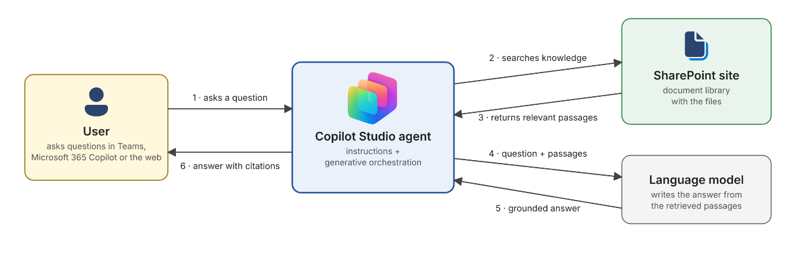
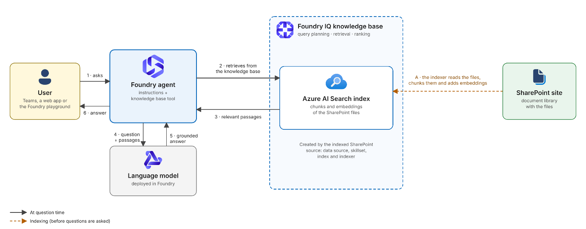

Customers often ask me whether a Copilot Studio agent is enough to answer questions from their files, or whether they need Foundry. The technical differences matter, but so do ownership, the skills needed, lifecycle and pricing model. Copilot Studio is built for makers, while Foundry is built for engineering teams.

My recommendation is always the same: choose by owner first, then by technology. If the people who will keep the agent running are business makers, Copilot Studio fits. If an engineering team owns it, Foundry fits. An agent nobody on the team can maintain is the real risk.

## The experiment

I wanted to see how two Microsoft platforms handle retrieval-augmented generation (RAG) when everything else is held constant. So I built the same agent twice, over the same documents, with the same model and the same instructions: once in **Copilot Studio**, using [Copilot Harness](https://learn.microsoft.com/en-us/microsoft-copilot-studio/agents-experience/overview?wt.mc_id=DX-MVP-5004680), and once in **Microsoft Foundry**. Then I asked both agents the same 50 questions and read every answer.

Everything I used (agent instructions, settings, test set) is in the repository: **[fchopo/rag-copilot-studio-vs-foundry](https://github.com/fchopo/rag-copilot-studio-vs-foundry)**.

Both platforms can ground an agent on your documents, but they give you very different levels of control. In Copilot Studio you point the agent at a [knowledge source](https://learn.microsoft.com/en-us/microsoft-copilot-studio/knowledge-copilot-studio?wt.mc_id=DX-MVP-5004680) and the platform decides how to chunk, index and retrieve. In Foundry you build a knowledge base on [Foundry IQ (Azure AI Search)](https://learn.microsoft.com/en-us/azure/foundry/agents/concepts/what-is-foundry-iq?wt.mc_id=DX-MVP-5004680&tabs=portal) and can choose how retrieval is planned and what it returns. I wanted to know whether that extra control shows up in answer quality, and what each platform costs.

This is the architecture of the Copilot Studio agent:

And this is the architecture of the Foundry agent:

## The Setup

The agents work over a subset of Vectara’s [Open RAG Benchmark](https://huggingface.co/datasets/vectara/open_ragbench) (arXiv part, licensed CC BY-NC 4.0). It has 396 papers that the benchmark questions point to, plus 100 randomly sampled papers that no question points to, so the agents also have to ignore irrelevant material. That makes 496 PDFs, all stored in one SharePoint library. The questions are about scientific papers, and many of them depend on tables and exact numbers.

Both agents use the [GPT-6-Luna](https://developers.openai.com/api/docs/models/gpt-6-luna) model and share the same instructions. These tell the agent to:

- Search for every question and answer only from the retrieved papers
- Give the direct answer first, report numbers exactly, and name the table

- Cite the paper title and arXiv ID
- Never ask clarifying questions

- Say plainly when the papers don’t contain the answer
- Correct false premises

- Decline questions that are not about the papers

The full instructions are in the repo.

## Test and results

The test set has 50 questions: 45 taken from the benchmark and 5 that test behaviour (two off-topic questions, one about a paper that is not in the collection, and two with a false premise).

Benchmark questions measure retrieval and answer quality. They come straight from the Open RAG Benchmark, and each has an expected answer from a known paper and section. They test whether the agent finds the right paper and extracts the right answer.

Behaviour questions measure discipline: refusing, admitting a gap and correcting the user. They test whether the agent follows its instructions when the right move is *not* to answer normally.

Both platforms offer automated evaluation, and I used it: Copilot Studio's [*General quality* and *Compare meaning*](https://learn.microsoft.com/en-us/microsoft-copilot-studio/analytics-agent-evaluation-overview?wt.mc_id=DX-MVP-5004680), and in Foundry [*Similarity*, *Response completeness*, *Relevance* and *Groundedness*](https://learn.microsoft.com/en-us/azure/foundry/concepts/built-in-evaluators?wt.mc_id=DX-MVP-5004680), judged by GPT-5.2.

The automated scores were of limited use. Foundry’s judges were generous, averaging 4.6–4.9 out of 5, and at least 48 of 50 answers passed each evaluator. Only Groundedness clearly flagged the answer that came from memory. The judges also misjudged some correct answers:

- **Copilot Studio’s General quality** failed correct refusals because the question was left “unanswered”.
- **Copilot Studio’s Compare meaning** failed correct answers that were longer than the expected one.

- **Foundry’s Relevance** gave the two correct refusals low scores.

Use the judges to find answers worth reading, not to decide, and hand-check a sample before approving a release.

I also scored all 50 answers by hand against the expected answers:

- 2 for a correct answer
- 1 for a partly correct one

- 0 for a wrong answer or for “I couldn’t find this” when the papers do contain the answer.

|                              | **Copilot Studio** | **Foundry** |
|------------------------------|--------------------|-------------|
| Benchmark questions (max 90) | 81                 | 89          |
| Behaviour questions (max 10) | 8                  | 6           |
| Total                        | 89                 | 95          |

**Copilot Studio’s weakness: retrieval.** In several benchmark questions it failed to find information that Foundry found. It either said the papers didn’t contain the answer, left a false premise uncorrected, or gave a generic answer that missed the actual method. The model and instructions were identical, so the gap points to retrieval. This can’t be proven, because Copilot Studio doesn’t show the passages it retrieved. Foundry does, so you can tell whether retrieval or the model failed.

**Foundry’s weakness: answering from memory.** When asked about a paper that isn’t in the collection, Foundry answered from its own knowledge, even though the instructions say to answer only from retrieved papers. Copilot Studio correctly said it couldn’t find it. Foundry also misread a table and wrongly said the numbers contradicted the paper’s claim. On the two off-topic questions, both agents declined, but only Copilot Studio said it covers just this paper collection, as expected.

## Cost and speed

|                           | **Copilot Studio**                   | **Foundry**                                                                                                 |
|---------------------------|--------------------------------------|-------------------------------------------------------------------------------------------------------------|
| What is billed            | Copilot Credits                      | Model tokens, Foundry IQ ranking tokens, and the search service itself                                      |
| Average per answer        | 2.88 credits                         | 17,264 input and 199 output tokens                                                                          |
| Estimated cost per answer | About \$0.029 (at \$0.01 per credit) | About \$0.002 to \$0.020 for the model, plus query planning and search ranking                              |
| Cost for the 50 questions | 144 credits, about \$1.44            | About \$0.09 to \$1.02 for the model                                                                        |
| Response time             | Not exported by Copilot Studio       | 20s average                                                                                                 |
| Fixed monthly cost        | None with pay-as-you-go              | An Azure AI Search service, billed whether or not it is used: roughly \$65 to \$70 a month for a Basic tier |

**Per answer, the two cost about the same**, but the totals differ. Foundry needs an Azure AI Search service, which is billed every month whether or not anyone uses the agent. At the volume of this experiment, that fixed fee far outweighs the cost of the answers: the 50 questions cost a few dollars at most, while the service costs tens of dollars a month. As a rough guide, **Foundry only becomes the cheaper option above a few thousand answers a month.**

## Conclusions

**Foundry answered better, Copilot Studio behaved better.** Both agents faced the same 50 questions with the same model and instructions. Foundry scored 95 out of 100 in the hand scoring, against 89 for Copilot Studio. Its lead came from the benchmark questions (89 vs 81 out of 90), where it found answers that Copilot Studio said it couldn’t find. Copilot Studio did better on the behaviour questions (8 vs 6 out of 10). For a paper that isn’t in the collection, Foundry answered from memory instead of admitting it couldn’t find it.

**Retrieval made the difference.** The model and instructions were identical, so the gap points to what each platform retrieves. Foundry shows the retrieved passages and lets you tune how retrieval works, so it’s easier to tell why an answer went wrong. **Copilot Studio is quicker to set up and comes with Teams and Microsoft 365 Copilot channels, but it gives you less to tune.**

**Cost depends on volume.** Per answer, the two are in the same range: about three cents for Copilot Studio, and between a fifth of a cent and two cents of model cost for Foundry, plus search costs. Foundry, however, also needs an Azure AI Search service billed monthly, and Copilot Studio has no equivalent. **At low volume, Copilot Studio is cheaper overall. Foundry’s fixed fee only pays off with enough traffic, or when you need its control over retrieval.**
